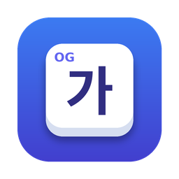

<p align="center">
  
</p>

<h1 align="center">OG키보드</h1>

<p align="center">
  애플 실리콘 맥용 한글 입력기<br>
  세벌식 390 · 391 · 순아래 · 두벌식 / 모아치기 · 한자 · 바로잡기 · 단축어 · 클립보드 기록
</p>

<p align="center">
  <a href="../../releases/latest"></a>
  
  
</p>

---

## ✨ 주요 기능

- **세벌식 390 · 391 · 순아래, 두벌식** — 모아치기(초·중·종성 순서 상관없이), 자모 단위 지우기
- **한/영 전환** — Caps Lock 짧게, 오른쪽 ⌘ 짧게. Caps Lock 길게는 대문자 고정. 앱마다 마지막 한/영 기억
- **로그인 칸 자동 영문** — 웹의 아이디·이메일·비밀번호 칸에 들어가면 영문, 나오면 원래대로
- **바로잡기** — 한/영을 잘못 놓고 친 글자를 오른쪽 ⌘ 길게로 되살림 (`dkssud` → 안녕)
- **한자 · 기호 · 이모지** — 오른쪽 ⌥로 후보 창, 두 번 누르면 이모지 전체 창
- **텍스트 단축어** — `오늘` + 오른쪽 ⌥ → "11월 1일 일요일". 날짜 계산, 클립보드, 커서 위치 지원
- **클립보드 기록** — ⌃⌥V로 최근 복사한 것 20개 (민감 정보는 기록 안 함)
- **터미널 지원** — iTerm2, 터미널, Termix 등에서도 한자·바로잡기 동작

## 💻 요구 사항

- 애플 실리콘(M 시리즈) 맥
- macOS 13 Ventura 이상

## 📦 설치

### 방법 1. 터미널 한 줄 (권장)

```bash
curl -fsSL https://raw.githubusercontent.com/ohnggni/og-keyboard-mac/main/install.sh | bash
```

최신 릴리스를 내려받아 `~/Library/Input Methods`에 설치하고 입력 소스에 등록합니다. 업데이트도 같은 명령입니다.

### 방법 2. 직접 설치

1. [릴리스](../../releases/latest)에서 `OGKeyboard.zip`을 내려받아 압축을 풉니다.
2. Finder에서 `⌘⇧G` → `~/Library/Input Methods` 로 이동해 `OGKeyboard.app`을 넣습니다.
3. 인터넷에서 받은 파일이라 맥이 실행을 막을 수 있으므로, 터미널에서 격리 표시를 지웁니다.
   ```bash
   xattr -dr com.apple.quarantine ~/Library/Input\ Methods/OGKeyboard.app
   ```
4. 로그아웃 후 다시 로그인합니다.

> ℹ️ Apple 개발자 서명·공증을 거치지 않은 앱입니다. 방법 1은 격리 표시가 붙지 않게 내려받으므로 따로 할 일이 없습니다.

## ⚙️ 처음 설정

### 1. 입력 소스 추가

**시스템 설정 → 키보드 → 입력 소스 → 편집 → `+` → 한국어 → OG키보드** 를 추가합니다.
목록에 없으면 로그아웃 후 다시 로그인하십시오.

영문은 OG키보드 안에서 처리하므로 순정 **ABC**는 비상용으로만 남겨 두면 됩니다.

### 2. Caps Lock 설정 끄기

같은 화면에서 **"Caps Lock으로 라틴 입력 소스 전환"** 을 끕니다. 켜 두면 맥이 Caps Lock을 가로채 순정 입력기로 바꿔 버립니다.
Karabiner 등에 Caps Lock으로 입력 소스를 바꾸는 규칙이 있다면 그것도 지워야 합니다.

### 3. 권한

**시스템 설정 → 개인정보 보호 및 보안** 에서 두 곳에 **OGKeyboard**를 켭니다. 처음 쓸 때 요청 창이 뜨기도 하고, 목록에 없으면 `+`로 `~/Library/Input Methods/OGKeyboard.app`을 추가합니다.

| 권한 | 쓰는 곳 | 없으면 |
|---|---|---|
| **손쉬운 사용** | 터미널에서 한자·바로잡기, 단축어 `{커서}` 이동, 로그인 칸 알아보기 | 일반 앱의 기본 입력은 되지만 위 기능이 제한됨 |
| **입력 모니터링** | Caps Lock 한/영 (누른 시간을 재기 위해) | Caps Lock 한/영이 동작하지 않음 (오른쪽 ⌘는 됨) |

권한을 켠 뒤에는 입력기를 한 번 다시 시작합니다: `pkill -x OGKeyboard` (아무 데서나 글자를 치면 다시 뜹니다)

## ⌨️ 키 요약

| 키 | 동작 |
|---|---|
| `Caps Lock` 짧게 | 한/영 |
| `Caps Lock` 길게 | 대문자 고정 (풀면 원래 상태로) |
| 오른쪽 `⌘` 짧게 | 한/영 |
| 오른쪽 `⌘` 길게 | 바로잡기 (2초 안에 다시 = 한 낱말 더, 선택 영역도 가능) |
| 오른쪽 `⌥` | 한자 · 기호 · 이모지 · 단축어 후보 |
| 오른쪽 `⌥` 두 번 | 이모지 전체 창 |
| `⌃⌥V` | 클립보드 기록 |

메뉴바의 **OG** 아이콘에서 자판 선택, 단축어 관리, 앱별 설정, 전체 사용법을 볼 수 있습니다.

## 🔄 업데이트

설치 명령을 다시 실행하면 됩니다.

```bash
curl -fsSL https://raw.githubusercontent.com/ohnggni/og-keyboard-mac/main/install.sh | bash
```

> ⚠️ 개발자 서명이 없는 앱이라 버전이 바뀌면 맥이 다른 앱으로 보고 **권한이 풀릴 수 있습니다.** 업데이트 후 기능이 안 되면 손쉬운 사용·입력 모니터링 목록에서 OGKeyboard를 `−`로 지우고 다시 추가하십시오.

## 🗑️ 제거

```bash
curl -fsSL https://raw.githubusercontent.com/ohnggni/og-keyboard-mac/main/uninstall.sh | bash
```

입력 소스 목록과 권한 목록의 OG키보드는 시스템 설정에서 직접 지우십시오.
설정·단축어·클립보드 기록까지 지우려면 `defaults delete kr.ogapp.inputmethod.OGKeyboard` 를 실행합니다.

## 🛟 문제 해결

<details>
<summary><b>어디서나 영문만 입력됩니다</b></summary>

맥의 **보안 입력**이 켜진 채 안 풀린 상태일 수 있습니다 (주로 브라우저의 비밀번호 칸). 보안 입력 중에는 맥이 모든 입력기를 막습니다.
메뉴바 OG 메뉴 맨 위에 ⚠️ 표시와 함께 원인 앱이 나오므로, 그 앱을 종료하면 풀립니다.
</details>

<details>
<summary><b>특정 앱에서만 입력이 안 되거나 영문만 됩니다</b></summary>

1. 입력 소스 목록에서 OG키보드 제거
2. 설치 명령 다시 실행
3. 로그아웃 후 다시 로그인
4. 입력 소스에 OG키보드 다시 추가

그래도 안 되면 메뉴바 → **이 앱에서 → 순정 입력기 쓰기** 를 켜면 그 앱에서만 순정 입력기로 자동 전환됩니다.
</details>

<details>
<summary><b>한자·바로잡기가 엉뚱한 글자를 바꿉니다</b></summary>

메뉴바 → **이 앱에서 → 터미널처럼 다루기** 를 켜십시오. 앱이 입력기에 알려주는 글자 정보가 정확하지 않은 경우(터미널류)에 씁니다.
</details>

<details>
<summary><b>Caps Lock 한/영이 안 됩니다</b></summary>

- 입력 모니터링 권한을 확인하고 `pkill -x OGKeyboard` 로 다시 시작
- "Caps Lock으로 라틴 입력 소스 전환"이 꺼져 있는지 확인
- Karabiner 등 다른 키 변경 도구의 Caps Lock 규칙 확인
</details>

## 🔒 개인정보

입력한 글자, 클립보드 기록, 단축어, 설정은 모두 이 맥 안에만 저장되며 외부로 전송하지 않습니다. 네트워크 기능이 없습니다.

## 🛠️ 직접 빌드

Xcode(또는 Command Line Tools)가 있는 애플 실리콘 맥에서:

```bash
git clone https://github.com/ohnggni/og-keyboard-mac.git
cd og-keyboard-mac
./dev.sh          # 받아오기 → 테스트 → 빌드 → 설치 → 등록
./dev.sh log      # 입력기 로그 보기
```

키체인에 코드 서명용 인증서 `OGKeyboard Dev`(자체 서명)를 만들어 두면 빌드할 때마다 권한이 풀리지 않습니다.

| 경로 | 내용 |
|---|---|
| `Sources/HangulCore/` | 조합기·자판·한자 사전·한↔영 변환·단축어 (맥 의존성 없음, `swift test`) |
| `App/` | 입력기 본체 (InputMethodKit), 메뉴바, 후보 창, 사용법 |
| `tools/` | 진단 도구 (입력 소스 속성, 입력칸 정보 등) |

## 📄 라이선스

OG키보드 코드는 [MIT 라이선스](LICENSE)입니다. 함께 들어 있는 데이터는 각자의 라이선스를 따릅니다 ([licenses/](licenses)).

- 자판 표: [libhangul](https://github.com/libhangul/libhangul) (LGPL-2.1)
- 한자 사전: libhangul hanja (BSD-3-Clause)
- 이모지 이름: Unicode CLDR (Unicode-3.0), [emojibase](https://emojibase.dev) (MIT)

문의: og.app.developer@gmail.com
